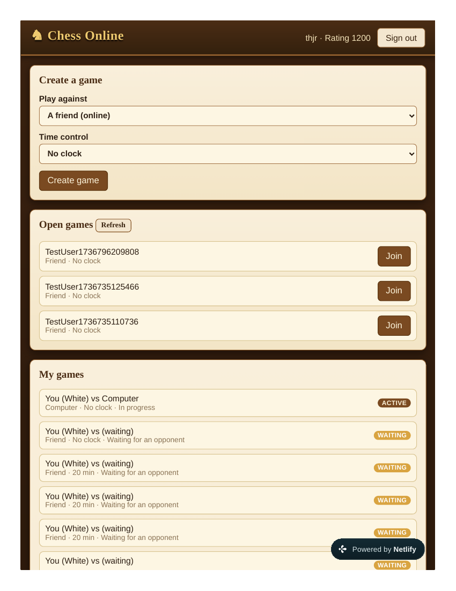

# ♞ Chess Online

A browser-based chess game with accounts, ratings, online friend games, a built-in computer opponent, and a live lobby chat — restored and rebuilt in November 2026.

**▶ Play it live:** https://thjr-chess-online.netlify.app

## The game

- **Accounts & ratings** — sign up, sign in, and carry a persistent rating (starts at 1200, +24 for a win, −24 for a loss)
- **Play the computer** — a built-in chess engine answers your moves in the browser
- **Play a friend online** — create an open game, a friend joins from the lobby, and moves update live
- **Clocks** — optional time controls (3, 5, 10, or 20 minutes) or no clock
- **Full rules chess** — legal moves, check, checkmate, stalemate, castling, en passant, and promotion
- **Lobby chat** — a shared chat room for everyone signed in
- **Classic wooden look** — dark walnut and parchment, styled after the original 2025 version

## The story

Chess Online was first built in January 2025, with a Supabase backend holding player accounts, games, and chat. The backend was later auto-paused after a long period of inactivity, and the original front end was lost.

In November 2026 the project was recovered end to end:

1. The February 2025 database backup was downloaded and restored into a new Supabase project — all 7 accounts and 153 historical games verified row for row.
2. Four dead ends in the original access rules (players could not see open games, join them, finish them, or create stats) were found and fixed with additional policies.
3. A new front end was built against the restored database — full chess engine, live play, computer opponent — and deployed.
4. The restored accounts were verified working again, including a password reset for the owner's account.

## Tech

- Static front end (HTML, CSS, JavaScript) hosted on Netlify
- Supabase (Postgres, Auth, Realtime) backend with row-level security
- Chess engine written in vanilla JavaScript (move generation verified by perft tests)

---

*Personal project by Honey Leen Rivera.*
